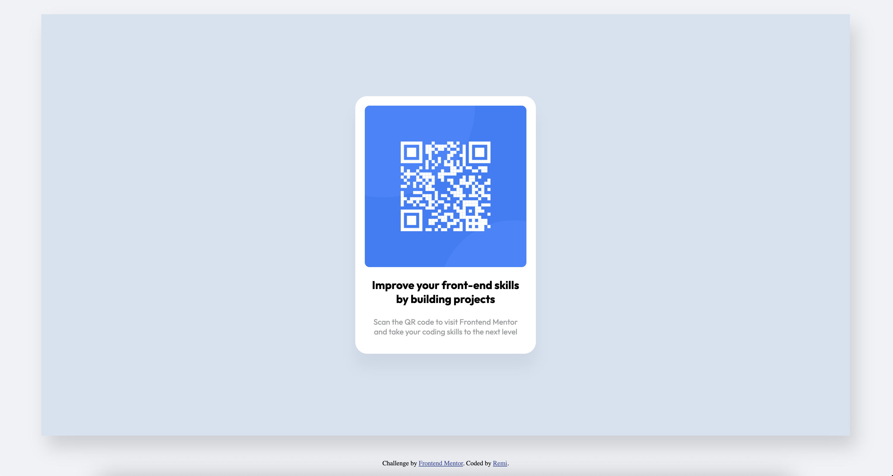

# Frontend Mentor - QR Code Component Solution

Esta es una solución al reto del [QR code component en Frontend Mentor](https://www.frontendmentor.io/challenges/qr-code-component-iux_sio38). 

## Tabla de contenidos

- [Vista previa](#vista-previa)
- [Enlaces](#enlaces)
- [Tecnologías utilizadas](#tecnologías-utilizadas)
- [Lo que aprendí](#lo-que-aprendí)
- [Autora](#autora)

---

## Vista previa

---

## Enlaces

- **URL de la solución en GitHub:** [Repositorio del proyecto](https://github.com/alonsoremedios/PaginasWeb-Practica)
- **Sitio web en vivo (GitHub Pages):** [Ver solución online](https://alonsoremedios.github.io/PaginasWeb-Practica/)

---

## Tecnologías utilizadas

- HTML5 semántico
- Propiedades personalizadas de CSS3
- Flexbox para centrado horizontal y vertical
- Diseño adaptativo (Responsive Web Design con unidades relativas como `rem` y `%`)
- Metodología BEM para nombres de clases

---

## Lo que aprendí

Durante este proyecto practiqué cómo centrar un componente de forma fluida tanto en dispositivos móviles como en pantallas de escritorio sin depender de alturas fijas en píxeles.

Conceptos clave reforzados:
- El uso de `width: 90%` y `max-width` en `rem` para evitar que la tarjeta desborde en pantallas pequeñas.
- Centrado del elemento principal utilizando Flexbox en el contenedor padre.
- La importancia de aplicar `width: 100%` y `height: auto` a las imágenes para hacerlas completamente responsivas dentro de su tarjeta contenedora.

---

## Autora

- GitHub - [@alonsoremedios](https://github.com/alonsoremedios)